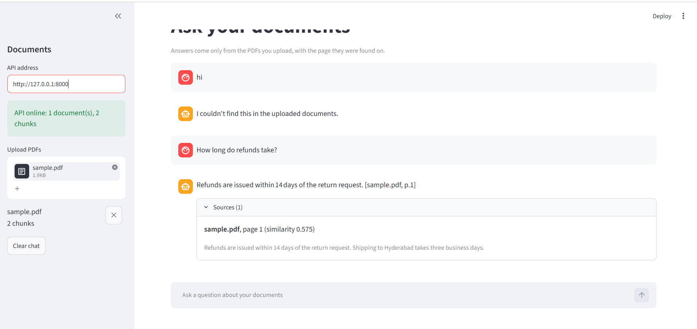

# RAG Document Q&A

Upload PDFs and ask questions in plain language. Answers come **only from your documents** and show the file and page they were found on. If the documents don't contain the answer, the app says so instead of guessing.




## How it works

```
PDF --> split into overlapping chunks (keeping file + page)
    --> embed each chunk with a local model (all-MiniLM-L6-v2)
    --> store vectors in Chroma (on disk)

question --> embed --> find the closest chunks (cosine similarity)
         --> too dissimilar? answer "not found" without calling the LLM
         --> otherwise send chunks + question to the LLM with strict rules:
             use only this context, cite [file, page], or say you don't know
         --> answer + sources
```

## Features

- PDF upload, document list and delete through a REST API (FastAPI) and a chat page (Streamlit)
- Answers cite the file and page; every answer lists its sources with similarity scores
- Refuses to answer when nothing relevant is found, and skips the LLM call in that case
- Local embeddings, so no per-document API cost; the LLM provider is switchable (Gemini or Groq) through `.env`
- Re-uploading a file replaces its old chunks; scanned or corrupt PDFs are rejected with a clear message
- The API never returns raw error details to the client; they go to the server log

## Tech stack

Python 3.12 · FastAPI · Streamlit · Chroma · sentence-transformers · pypdf · Gemini / Groq · pytest · GitHub Actions · Docker

## Project layout

```
app/
  ingest.py       PDF reading and chunking
  embeddings.py   embedding models (real and a tiny test stand-in)
  vectorstore.py  Chroma store and an in-memory store with the same interface
  retrieval.py    index chunks, find the closest chunks
  llm.py          Gemini and Groq clients, plus a fake for tests
  qa.py           prompt building and the answer step
  service.py      application logic: validation, saving, indexing, asking
  main.py         FastAPI endpoints
ui/
  api_client.py   client for the API
  streamlit_app.py  chat page
tests/            unit and API tests (fakes, no network needed)
```

## Quick start

1. Install Python 3.12 (PyTorch does not support the newest Python versions yet).
2. Create the environment and install:
   ```
   python -m venv .venv
   .venv\Scripts\python.exe -m pip install -r requirements.txt
   ```
   On macOS or Linux use `.venv/bin/python` instead.
3. Create a free API key (Gemini from Google AI Studio, or Groq), copy `.env.example` to `.env`, and fill in `LLM_PROVIDER` and the matching key and model. Never commit `.env`.
4. Start the API: `python -m uvicorn app.main:app`
5. In a second window, start the page: `python -m streamlit run ui/streamlit_app.py`
6. Open http://localhost:8501, upload a PDF and ask a question.

The API's interactive docs are at http://127.0.0.1:8000/docs.

## API

| Method | Path | What it does |
|---|---|---|
| GET | `/health` | Status, number of documents and chunks |
| POST | `/documents` | Upload a PDF (max 20 MB) and index it |
| GET | `/documents` | List uploaded documents |
| DELETE | `/documents/{filename}` | Remove a document and its chunks |
| POST | `/ask` | `{"question": "...", "k": 4}` returns an answer with sources |

## Tests

```
python -m pytest
```

The tests use a fake LLM and a simple hashing embedder, so they run without internet or API keys. GitHub Actions runs them on every push (`.github/workflows/ci.yml`).

## Docker

```
docker build -t rag-doc-qa .
docker run --env-file .env -p 8501:8501 -v rag-data:/app/chroma_db rag-doc-qa
```

Then open http://localhost:8501.

## Limitations

- Text PDFs only. Scanned PDFs have no text layer and would need OCR.
- Answer quality depends on the LLM; the prompt and the similarity cutoff reduce, but do not remove, wrong answers.
- Single user, no login. Not meant to be exposed publicly as it is.
- Small documents are tested; there is no benchmark on large collections yet.

## Roadmap

- Evaluation on a set of questions with known answers
- Live deployment

## Author

Eithem Shashank · [GitHub](https://github.com/eithemshashankyadav)
